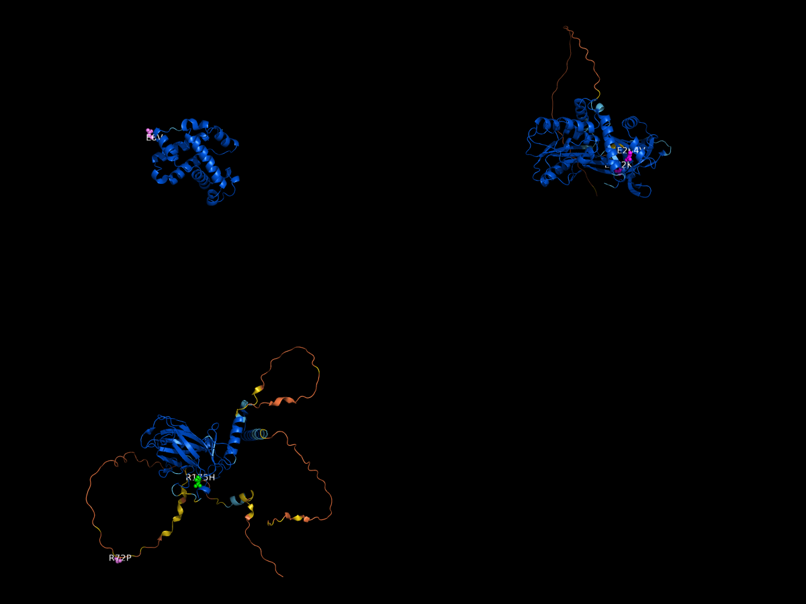
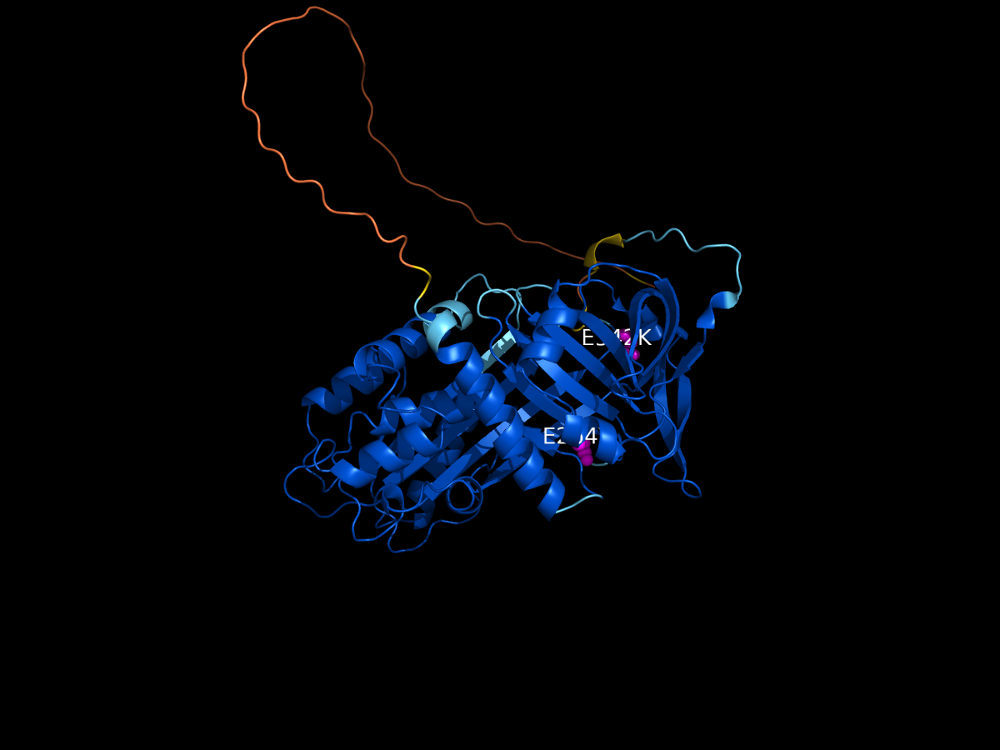

# af-confidence

[](https://github.com/wangnick1004/af-confidence/actions/workflows/tests.yml)

把文獻中的突變位置，正確對應到 AFDB 模型上

> 目前版本 v0.1.0（[更新紀錄](CHANGELOG.md)）。另見 [研究情境：把工具放進日常工作](#研究情境把工具放進日常工作)、
> [專案目標、方法與實作規劃](#專案目標方法與實作規劃)、[準確度驗證](#準確度驗證)。

## 中文使用說明

這份說明寫給**沒有程式背景**的使用者：照著做就能在自己的電腦上使用這個工具。
（專案目標、方法與準確度驗證請看本頁後面的 [專案目標、方法與實作規劃](#專案目標方法與實作規劃) 和 [準確度驗證](#準確度驗證)。）

---

### 目錄

1. [這個工具能做什麼](#1-這個工具能做什麼)
2. [準備：確認電腦有 Python](#2-準備確認電腦有-python)
3. [下載工具](#3-下載工具)
4. [第一次使用](#4-第一次使用)
5. [怎麼輸入](#5-怎麼輸入)
6. [怎麼讀結果](#6-怎麼讀結果)
7. [把結果存成 Excel 可以開的檔案](#7-把結果存成-excel-可以開的檔案)
8. [在 AlphaFold DB 網頁上標出正確位置](#8-在-alphafold-db-網頁上標出正確位置)
9. [在 ChimeraX 中標出正確位置](#9-在-chimerax-中標出正確位置)
10. [在 PyMOL 中標出正確位置](#10-在-pymol-中標出正確位置)
11. [在 Python 或 Jupyter／Colab 中使用](#11-在-python-或-jupytercolab-中使用)
12. [讓 AI 助理使用（MCP 伺服器）](#12-讓-ai-助理使用mcp-伺服器)
13. [常見問題](#13-常見問題)
14. [這個工具不做的事](#14-這個工具不做的事)
15. [引用與授權](#15-引用與授權)

---

### 1. 這個工具能做什麼

同一個突變，在不同文獻中常用不同的編號。例如鐮刀型貧血的突變，教科書寫 **E6V**（第 6 個胺基酸 E 變成 V），但 AlphaFold DB（AFDB）的模型上，**第 6 個是 P，E 在第 7 個**。AFDB 網站不會提醒你，你可能就看錯了位置。

這個工具會：

- 檢查你輸入的突變位置，在 AFDB 模型上**對不對得上**
- 對不上時，**說明可能的原因並指出正確位置**，並告訴你這個建議**有多可信**
- 一次檢查**一整份清單**，找出單獨看一個突變時發現不了的錯誤

只要輸入蛋白質名稱和突變，例如：

```
HBB E6V
```

工具就會回答：「第 6 個是 P，不是 E；加 1 之後 E7V 對得上，因為 UniProt 標註這個蛋白質的第一個胺基酸會被移除。」

---

### 2. 準備：確認電腦有 Python

這個工具用 Python 寫成，需要 **Python 3.9 或更新的版本**。除了 Python 本身，**不需要安裝任何其他東西**。

#### 打開終端機

| 電腦 | 怎麼打開 |
|---|---|
| **Mac** | 按 `⌘ + 空白鍵`，輸入「終端機」或「Terminal」，按 Enter |
| **Windows** | 按開始鍵，輸入「PowerShell」，按 Enter |

#### 確認 Python 版本

在終端機輸入以下指令，按 Enter：

| 電腦 | 指令 |
|---|---|
| Mac、Linux | `python3 --version` |
| Windows | `py --version` |

看到 `Python 3.9.x` 或更大的數字（3.10、3.11、3.12、3.13…）就可以了。

> **本說明之後的指令都寫 `python3`。Windows 使用者請一律改成 `py`。**

#### 如果顯示找不到指令

- **Mac：** 輸入 `python3 --version` 時，可能會跳出視窗，請你安裝「命令列開發者工具」。按「安裝」，等它裝完，再輸入一次指令。
- **Windows：** 到 <https://www.python.org/downloads/> 下載安裝。安裝的第一個畫面，**一定要勾選「Add python.exe to PATH」**，再按「Install Now」。裝完後關掉 PowerShell 再重新打開。

---

### 3. 下載工具

選一種方式就好。

#### 方式 A：下載 ZIP（不需要 git，最簡單）

1. 打開 <https://github.com/wangnick1004/af-confidence>
2. 按綠色的 **「Code」** 按鈕，選 **「Download ZIP」**
3. 解壓縮，會得到一個叫 `af-confidence-main` 的資料夾
4. 把這個資料夾放到好找的地方，例如「文件」

#### 方式 B：用 git 在終端機下載（之後更新比較方便）

```bash
git clone https://github.com/wangnick1004/af-confidence
```

```bash
cd af-confidence
```

之後要更新到最新版，進入資料夾後執行 `git pull` 即可。Mac 第一次使用 `git` 時，如果跳出視窗要求安裝「命令列開發者工具」，按「安裝」即可。

#### 方式 C：只用終端機下載 ZIP（沒有 git 時）

**Mac、Linux：**

```bash
curl -L -o af-confidence.zip https://github.com/wangnick1004/af-confidence/archive/refs/heads/main.zip
```

```bash
unzip af-confidence.zip
```

```bash
cd af-confidence-main
```

**Windows（PowerShell）：**

```powershell
Invoke-WebRequest -Uri https://github.com/wangnick1004/af-confidence/archive/refs/heads/main.zip -OutFile af-confidence.zip
```

```powershell
Expand-Archive af-confidence.zip -DestinationPath .
```

```powershell
cd af-confidence-main
```

#### 方式 D：安裝成指令（進階）

不想每次都進入資料夾的話，可以用 pip 直接從 GitHub 安裝（需要電腦有 git）：

```bash
python3 -m pip install git+https://github.com/wangnick1004/af-confidence
```

沒有 git 的話，改成：

```bash
python3 -m pip install https://github.com/wangnick1004/af-confidence/archive/refs/heads/main.zip
```

安裝後在**任何資料夾**都能執行 `python3 -m af_confidence HBB E6V`。注意：

- 這種方式**不包含**範例清單（`examples/`）和離線示範資料（`data/cache/`），需要連網使用。
- 有些電腦會擋這種安裝（出現 `externally-managed-environment` 錯誤），或裝好後輸入 `af-confidence` 找不到指令。遇到時，改用方式 A～C，或一律用 `python3 -m af_confidence` 執行。

#### 進入工具的資料夾

**之後每次使用，都要先讓終端機「進入」工具的資料夾。** 最簡單的方法：

1. 在終端機輸入 `cd`，**後面加一個空格**（先不要按 Enter）
2. 把工具的資料夾**直接拖進終端機視窗**，路徑會自動填上
3. 按 Enter

確認有沒有進對資料夾：Mac 輸入 `ls`、Windows 輸入 `dir`，應該會看到 `README.md`、`af_confidence`、`examples` 等檔案。

---

### 4. 第一次使用

進入工具的資料夾後，輸入：

```bash
python3 -m af_confidence HBB E6V
```

第一次使用需要連上網路，工具會從 AFDB 和 UniProt 下載資料，存在電腦裡；之後查同一個蛋白質就不用再下載。你會看到：

```
HBB -> P68871  (AlphaFold DB model AF-P68871-F1)
XX E6V: model has P at 6, not E
     -> [medium] annotated_offset: +1: E7V matches; UniProt: initiator Met removed; mature chain 'Hemoglobin subunit beta' starts at 2 (explains 1/1 mismatched input) [pLDDT 96.56]

Evidence: strong = several inputs agree and that is unlikely by chance; medium = one input fits (right about 9 times in 10 in the benchmark); weak = could easily be chance.
pLDDT values are shown as provided by AlphaFold DB, not reinterpreted. This tool does not predict variant effects.
```

逐行說明：

| 輸出 | 意思 |
|---|---|
| `HBB -> P68871` | 基因名稱 HBB 對應到 UniProt 編號 P68871 |
| `AlphaFold DB model AF-P68871-F1` | 比對的是這個 AFDB 模型 |
| `XX E6V: model has P at 6, not E` | ❌ 對不上：模型第 6 個是 P，不是 E |
| `-> [medium] annotated_offset: +1: E7V matches` | 建議：加 1 之後，E7V 對得上 |
| `UniProt: initiator Met removed` | 原因：UniProt 標註第一個甲硫胺酸（Met）會被移除，所以傳統編號從下一個開始算 |
| `[pLDDT 96.56]` | AFDB 對第 7 個位置的信心分數（照 AFDB 原值顯示） |
| `[medium]` | 這個建議的可信程度，見[第 6 節](#證據強度strong--medium--weak) |
| 最後兩行 | 證據強度的說明，以及「本工具不預測突變的影響」的聲明 |

如果改用正確的編號：

```bash
python3 -m af_confidence HBB p.Glu7Val
```

```
HBB -> P68871  (AlphaFold DB model AF-P68871-F1)
OK p.Glu7Val: matches the model sequence (pLDDT 96.56)
```

`OK` 表示對得上。

> **沒有網路時：** 工具資料夾裡已經存了幾個示範蛋白質（HBB、SERPINA1、TP53、APP、BTD）的資料。在指令後面加上 `--cache data/cache --offline`，不用網路也能執行這些示範。

---

### 5. 怎麼輸入

#### 基本格式

```
python3 -m af_confidence  蛋白質  突變1  突變2  ...
```

**第一個詞是蛋白質，後面是突變**，用空格或逗號分開。

#### 蛋白質可以這樣寫

| 寫法 | 範例 | 說明 |
|---|---|---|
| 基因名稱 | `HBB`、`TP53`、`p53` | 預設查人類；大小寫都可以，常見別名也查得到 |
| UniProt 編號 | `P68871` | 最準確；在 <https://www.uniprot.org> 查得到 |
| 異構體編號 | `P04637-2` | 比對該異構體的模型 |
| 其他物種的基因 | `Trp53 --organism 10090` | 10090 是小鼠，10116 是大鼠，7955 是斑馬魚 |

#### 突變可以這樣寫

| 寫法 | 範例 |
|---|---|
| 單字母 | `E6V` |
| 單字母加 `p.` | `p.E6V` |
| 三字母 | `Glu6Val` |
| 三字母加 `p.` | `p.Glu6Val`、`p.(Glu6Val)` |
| 無義突變（變成終止密碼子） | `R213*`、`p.Arg213Ter` |

**不支援：** DNA 層級的寫法（`c.20A>T`）、缺失或插入（`p.Glu6del`）、基因體座標。這些請改用 Ensembl VEP 或 EBI ProtVar。

#### 一次檢查一整份清單（建議這樣用）

如果你從文獻整理出一份突變清單，**把整份清單一起檢查，比一個一個檢查可靠得多**（原因見[第 6 節](#為什麼要整份清單一起檢查)）。

**步驟 1：建立清單檔**

每行寫一個蛋白質，後面接它的突變；`#` 後面可以寫註解，例如出處：

```
# 從三篇論文整理的突變
HBB      E6V            # 鐮刀型貧血，傳統編號
SERPINA1 E342K, E264V   # Z 型與 S 型
TP53     R175H R72P
```

用什麼軟體建立：

| 電腦 | 軟體 | 注意 |
|---|---|---|
| **Mac** | 「文字編輯」(TextEdit) | ⚠️ **一定要先選選單「格式」→「製作純文字」**，再存檔。預設的 RTF 格式工具讀不了 |
| **Windows** | 「記事本」(Notepad) | 直接存成 `.txt` 即可 |

檔名建議用英文，例如 `my_variants.txt`，存在工具的資料夾裡。

**步驟 2：執行**

```bash
python3 -m af_confidence -f my_variants.txt
```

如果整份清單都是同一個蛋白質，清單裡可以只寫突變，把蛋白質寫在指令上：

```bash
python3 -m af_confidence APP -f examples/app_abeta_numbering.txt
```

工具資料夾的 `examples/` 裡有三份範例清單可以參考。

清單中同一個蛋白質（不論寫基因名稱還是 UniProt 編號）的突變會合併在一起檢查；某個蛋白質查不到時，只會回報它的錯誤，其他照常輸出。

#### 所有選項

| 選項 | 說明 |
|---|---|
| `-f 檔案`、`--file 檔案` | 讀取清單檔；可以重複使用，一次讀多個檔案 |
| `--organism 物種代碼` | 查基因名稱時用的物種（NCBI taxonomy ID），預設 9606（人類） |
| `--format text`／`tsv`／`json`／`afdb`／`chimerax`／`pymol` | 輸出格式：一般文字（預設）、TSV（可用 Excel 開啟）、JSON（給程式讀取）、AFDB 自訂標註（見[第 8 節](#8-在-alphafold-db-網頁上標出正確位置)）、ChimeraX 腳本（見[第 9 節](#9-在-chimerax-中標出正確位置)）、PyMOL 腳本（見[第 10 節](#10-在-pymol-中標出正確位置)） |
| `--cache 資料夾` | 下載資料的存放位置，預設 `~/.cache/af-confidence` |
| `--offline` | 不連網，只用已下載的資料 |
| `--version`、`-h` | 顯示版本、顯示說明 |

工具連網失敗時會自動重試 3 次。執行結束時的結束代碼（寫腳本時才會用到）：全部對得上為 0，有任何對不上或可能是巧合為 1，有蛋白質查不到或網路錯誤為 2。

---

### 6. 怎麼讀結果

#### 每個突變開頭的符號

| 符號 | 意思 | 你該做什麼 |
|---|---|---|
| `OK` | 對得上 | 可以直接使用這個位置 |
| `XX` | 對不上（或超出模型範圍） | 看下方的建議 |
| `!?` | **對得上，但可能是巧合** | 特別注意！見下方說明 |
| `??` | 突變寫法看不懂 | 檢查寫法，見[第 5 節](#突變可以這樣寫) |

#### 建議的種類

| 種類 | 意思 | 例子 |
|---|---|---|
| `annotated_offset` | 依 UniProt 的標註，加減某個數字後對得上。常見原因：傳統編號不算第一個甲硫胺酸、從去掉訊號胜肽的成熟蛋白質開始算、用片段自己的編號（例如 Aβ），或 UniProt 更新過序列 | HbS 的 E6V → E7V（+1）；Z 型的 E342K → E366K（+24） |
| `consistent_offset` | 沒有標註可以解釋，但同一個位移讓整份清單都對上 | 整份清單都少算了 5 格 |
| `isoform` | 在另一個異構體的模型上對得上 | 文獻用的是不同的異構體 |
| `swapped` | 模型在該位置已經是「變異後」的胺基酸，可能把前後寫反了 | TP53 的 R72P，其實應該是 P72R |
| `nearby` | 前後 3 格內有這個胺基酸 | 可能打錯字，但也很可能只是巧合 |
| `ambiguous_match` | 照原本寫法對得上，但也符合整份清單的共同位移 | 見下方說明 |

#### 證據強度：strong / medium / weak

每個建議前面的方括號，表示這個建議有多可信。數字來自用 735 個真實突變做的驗證：

| 強度 | 意思 | 實際表現 |
|---|---|---|
| **strong** | 好幾個突變都指向同一個解釋，光靠巧合幾乎不可能 | 2,401 筆測試中只有 2 筆指錯，**幾乎可以直接相信** |
| **medium** | 只有一個突變符合，或符合一個具體的情況（例如寫反） | 大約 **10 次中對 9 次**；剩下的是單看一個突變分辨不出來的巧合，例如「打錯一格」和「不算第一個胺基酸」看起來一模一樣 |
| **weak** | 很可能只是巧合 | 只當作參考，要自己回去查原始文獻 |

#### 為什麼要整份清單一起檢查

任何一種胺基酸在隨機位置出現的機率大約是 1/20。所以編號錯了的時候，**錯的位置剛好是同一種胺基酸的機會，大約有 7～9%**。這時候工具和網站都會顯示「對得上」，完全沒有警告。

整份清單一起檢查時，工具可以發現：「其他突變都差了同樣的格數，這一個照理也應該差那麼多。」這時就會用 `!?` 標示出來。例如阿茲海默症相關的 APP 蛋白質：

```bash
python3 -m af_confidence APP -f examples/app_abeta_numbering.txt
```

```
XX A2T: model has L at 2, not A
     -> [strong] annotated_offset: +671: A673T matches; UniProt: 'C99', 'Amyloid-beta protein 42', 'Amyloid-beta protein 40' start at 672 (explains 4/4 mismatched inputs) [pLDDT 36.44]
...（A21G、E22G、E22Q 也都是 +671）
!? D23N: matches as written, but D694N (+671) also matches, the shift that explains 4/4 mismatched inputs
```

D23N 照原寫法「對得上」，因為 APP 第 23 個位置剛好也是 D。但其他四個都是用 Aβ 編號（要加 671），所以 D23N 真正的位置很可能是 D694N。**只輸入 D23N 一個突變時，任何工具都發現不了這個錯誤。**

#### 警告（warning）

結果中如果出現 `warning:` 開頭的行，請一定要看。常見的兩種：

- **UniProt 序列和 AFDB 模型不一致**：UniProt 更新了序列，但 AFDB 的模型還是舊的。工具會告訴你差幾格；如果 AFDB 有另一個模型和新序列相同，也會告訴你改用哪一個。範例：

  ```bash
  python3 -m af_confidence P43251 F108V A151T P371S
  ```

- **UniProt 標註無法取得**：通常是網路問題，這時工具無法用標註來解釋位移，結果可能不完整。

#### pLDDT

每個建議後面的 `[pLDDT 數字]`，是 AlphaFold 對該位置結構的信心分數（0～100），**工具照 AFDB 的原值顯示，不另外判讀**。一般的解讀方式：90 以上非常高、70～90 高、50～70 低、50 以下非常低。分數低的區域，3D 結構通常不能拿來解讀。

---

### 7. 把結果存成 Excel 可以開的檔案

在指令後面加上 `--format tsv`，再用 `>` 把結果存成檔案：

```bash
python3 -m af_confidence -f my_variants.txt --format tsv > 結果.tsv
```

然後在 Excel 選「檔案」→「開啟」，選 `結果.tsv`（檔案類型選「所有檔案」）。每一列是一個建議，欄位包括：蛋白質、突變、狀態、模型上的胺基酸、建議的種類、強度、建議的位置、pLDDT、說明。

---

### 8. 在 AlphaFold DB 網頁上標出正確位置

AlphaFold DB 從 2025 年 11 月起，可以在模型頁上加入「自訂標註」，在官方的結構檢視器中標出你指定的位置。工具可以直接產生要填進去的內容，**而且位置已經換算成該模型的編號**：

```bash
python3 -m af_confidence -f my_variants.txt --format afdb
```

輸出範例（節錄）：

```
== HBB -> P68871  https://alphafold.ebi.ac.uk/entry/AF-P68871-F1
   Track name:          Fixed medium
   Residues or ranges:  7
   from:
     E6V -> 7 (annotated_offset, medium)

== SERPINA1 -> P01009  https://alphafold.ebi.ac.uk/entry/AF-P01009-F1
   Track name:          Fixed strong
   Residues or ranges:  288, 366
   from:
     E342K -> 366 (annotated_offset, strong)
     E264V -> 288 (annotated_offset, strong)
```

**操作步驟：**

1. 打開輸出中 `==` 那一行的網址（每個模型一個網址）
2. 在模型頁的標註區（Annotations）打開標題為「**Add your annotation track**」的對話框
3. 「Track name」填入工具輸出的 Track name；「Residues or ranges」貼上後面的數字
4. 按「**Add track**」。同一個模型有多條軌跡時，每條重複一次

**四種軌跡：**

| 軌跡名稱 | 內容 |
|---|---|
| `OK as written` | 照原寫法就對得上的位置 |
| `Fixed strong` | 對不上，依 strong 證據校正後的位置 |
| `Fixed medium` | 對不上，依 medium 證據校正後的位置（大約 10 次對 9 次，重要的結果請回文獻確認） |
| `Ambiguous` | 照原寫法對得上、但可能是巧合的突變：原寫法的位置和建議的位置都會標出來 |

**注意：**

- 只有 strong 或 medium 的位置會放入；只有 weak 證據或無法解析的突變，會列在 `not placed:` 並說明原因。
- 一個突變可能對應到**兩個模型**（例如 UniProt 更新過序列的蛋白質），工具會分別列出兩個網址，並在 `warning:` 說明該用哪一個。
- AlphaFold DB **不能上傳檔案**，只能在對話框中輸入；標註只保存在瀏覽器分頁中，關閉分頁就會消失。要保存的話，可以用模型頁下載選單中的「Custom tracks (all)」匯出 CSV。
- 輸入格式是依 AlphaFold DB 網頁的程式碼確認的（每個位置字串都通過它自己的格式檢查）；開啟對話框的按鈕位置，請以實際網頁為準。

---

### 9. 在 ChimeraX 中標出正確位置

[ChimeraX](https://www.cgl.ucsf.edu/chimerax/) 是研究者常用的免費結構檢視軟體。工具可以產生一個 ChimeraX 腳本（`.cxc` 檔），開啟後會自動下載正確的 AlphaFold 模型，並把檢查過的位置標出來：

```bash
python3 -m af_confidence -f my_variants.txt --format chimerax > markers.cxc
```

在 ChimeraX 中開啟這個檔案：選單「File」→「Open」選擇 `markers.cxc`，或在 ChimeraX 的指令列輸入 `open` 加上檔案的完整路徑。

腳本會做這些事：

1. **先關閉 ChimeraX 目前開啟的所有內容**（`close session`），請先存好正在進行的工作
2. 用帶版本號的模型編號下載模型（例如 `alphafold fetch AF-P68871-F1-v6`），也就是工具比對時用的同一個模型；卡通圖依 pLDDT 上色
3. 在每個檢查過的位置顯示側鏈、上色，並加上突變名稱的標籤
4. 有多個模型時並排顯示，最後調整視角

| 側鏈顏色 | 意思 |
|---|---|
| lime（萊姆綠） | 照原寫法就對得上 |
| magenta（洋紅） | 依 strong 證據校正後的位置 |
| violet（紫羅蘭） | 依 medium 證據校正後的位置 |
| white（白） | 可能是巧合（ambiguous），標籤結尾加上 `?`，原寫法和建議的位置都會標出 |

每一組位置也會建立一個具名的選取範圍（例如 `afc_m1_fixed_strong`，`m1` 表示第 1 個模型），可以在 ChimeraX 選單「Select」→「User-Defined Selectors」中找到。只有 weak 證據或無法解析的突變不會被標出，會以註解列在腳本中。

**注意：**

- ChimeraX 需要連網才能下載模型。建議使用最新版的 ChimeraX。
- 腳本中的指令都已對照 ChimeraX 官方使用手冊確認，但**尚未在實際的 ChimeraX 中執行過**。如果開啟時出現錯誤，請把 ChimeraX 的 Log 視窗內容回報到 Issues。
- 檔名建議用英文（例如 `markers.cxc`），避免路徑中的中文造成問題。

---

### 10. 在 PyMOL 中標出正確位置

[PyMOL](https://pymol.org/) 是另一個常用的結構檢視軟體。工具可以產生 PyMOL 腳本（`.pml` 檔），執行後會下載正確的 AlphaFold 模型、依 pLDDT 上色，並把檢查過的位置標出來：

```bash
python3 -m af_confidence -f my_variants.txt --format pymol > markers.pml
```

在 PyMOL 中執行：選單「File」→「Run Script...」選擇 `markers.pml`，或在 PyMOL 的指令列輸入 `@` 加上檔案的完整路徑。



*上圖是用開源版 PyMOL 3.2 實際執行 `examples/mixed_proteins.txt` 產生的腳本所渲染的畫面：卡通圖依 pLDDT 上色（深藍為非常高、橘色為非常低），標記的位置以側鏈與小球顯示並加上標籤。R72P 落在橘色的低信心區域。*

腳本會做這些事：

1. **先刪除 PyMOL 中所有已載入的物件**（`delete all`），請先存好正在進行的工作
2. 從 AlphaFold DB 下載工具比對時用的同一個模型檔（PyMOL 的 `fetch` 不支援 AlphaFold DB 的編號，所以直接用模型檔網址）
3. 依 AlphaFold DB 的官方配色為卡通圖上色：深藍 > 90、淺藍 70～90、黃 50～70、橘 < 50
4. 在每個檢查過的位置顯示側鏈、上色並加上標籤；只替側鏈上色，卡通圖保留 pLDDT 的顏色
5. 有多個模型時分格顯示（grid mode），最後調整視角

| 側鏈顏色 | 意思 |
|---|---|
| green（綠） | 照原寫法就對得上 |
| magenta（洋紅） | 依 strong 證據校正後的位置 |
| violet（紫羅蘭） | 依 medium 證據校正後的位置 |
| white（白） | 可能是巧合（ambiguous），標籤結尾加上 `?` |

每一組位置也會建立具名的選取範圍（例如 `afc_m1_fixed_strong`），會出現在 PyMOL 右側的物件清單中。

這個腳本**已在開源版 PyMOL 3.2 中實際執行測試**：自動測試會在 PyMOL 中執行腳本，檢查每個模型都已載入、每個選取範圍都有選到原子、側鏈顏色正確、卡通圖保留 pLDDT 顏色、標籤數量正確。PyMOL 需要連網才能下載模型。

---

### 11. 在 Python 或 Jupyter／Colab 中使用

[](https://colab.research.google.com/github/wangnick1004/af-confidence/blob/main/examples/colab_quickstart.ipynb)

**最快的方式：** 按上面的「Open in Colab」按鈕，在瀏覽器中直接執行範例筆記本，不需要在自己的電腦上安裝任何東西。筆記本示範了檢查清單、用 pandas 整理結果、產生 AFDB 自訂標註和 ChimeraX 腳本，以及上傳自己的清單。

在自己的 Python 或 Jupyter 中使用，先用[第 3 節方式 D](#方式-d安裝成指令進階)安裝，然後：

```python
import af_confidence as afc

# 一個蛋白質
report = afc.check("HBB", ["E6V"])
print(afc.to_text(report))                 # 和命令列一樣的文字報告

# 一整份清單：{蛋白質: 突變}，或清單檔的路徑；同一個蛋白質會自動合併
reports = afc.check_list({"HBB": ["E6V"], "SERPINA1": ["E342K", "E264V"]})
reports = afc.check_list("my_variants.txt")

# 整理成表格
rows = afc.to_records(reports)             # 不需要其他套件：每個突變一個 dict
df = afc.to_dataframe(reports)             # pandas DataFrame（需要 pandas）

# 工作流程整合
print(afc.afdb_tracks(reports))            # 貼進 AlphaFold DB（第 8 節）
with open("markers.cxc", "w") as fh:       # 在 ChimeraX 中開啟（第 9 節）
    fh.write(afc.chimerax_script(reports))
with open("markers.pml", "w") as fh:       # 在 PyMOL 中執行（第 10 節）
    fh.write(afc.pymol_script(reports))
```

| 函式 | 用途 |
|---|---|
| `check(蛋白質, 突變)` | 檢查一個蛋白質的突變；突變可以是清單或一個字串（`"E342K, E264V"`） |
| `check_list(清單)` | 檢查整份清單；可傳入 `{蛋白質: 突變}`、`[(蛋白質, 突變), ...]` 或清單檔路徑。清單檔只有突變時，用 `protein="APP"` 指定蛋白質 |
| `to_text(結果)` | 和命令列相同的文字報告 |
| `to_records(結果)` | 每個突變一列：狀態、模型上的胺基酸、pLDDT，以及最佳建議的位置（`best_position`）、種類、強度、pLDDT。加上 `detail="suggestion"` 則每個建議一列 |
| `to_dataframe(結果)` | 同上，回傳 pandas DataFrame |
| `afdb_tracks(結果)`、`chimerax_script(結果)`、`pymol_script(結果)` | 第 8、9、10 節的三種輸出 |

每個函式都可以加上 `cache=`、`offline=True`、`organism=` 等設定，用法和命令列選項相同。蛋白質查不到時不會中斷，而是記錄在結果的 `error` 欄位；清單格式錯誤則會引發 `InputError`。

---

### 12. 讓 AI 助理使用（MCP 伺服器）

[MCP（Model Context Protocol）](https://modelcontextprotocol.io/) 讓 AI 助理（例如 Claude Code、Claude Desktop）可以呼叫外部工具。加入這個伺服器後，當你問 AI「論文寫的 E6V 在 AlphaFold 模型上是哪個位置？」，AI 會先用工具檢查編號，而不是直接拿錯的位置來回答。

**需要：** [uv](https://docs.astral.sh/uv/)。它會自動下載工具和需要的 Python 版本（MCP 套件需要 Python 3.10 以上，即使你的電腦是 Python 3.9 也沒關係）。安裝 uv：

```bash
curl -LsSf https://astral.sh/uv/install.sh | sh
```

（Windows 請在 PowerShell 執行 `powershell -ExecutionPolicy ByPass -c "irm https://astral.sh/uv/install.ps1 | iex"`；用 Homebrew 的話是 `brew install uv`。）

#### 加入 Claude Code

```bash
claude mcp add af-confidence -- uvx --python 3.12 --from "af-confidence[mcp] @ git+https://github.com/wangnick1004/af-confidence" af-confidence-mcp
```

加上 `-s user`（寫在 `add` 後面）可以讓所有專案都能使用。輸入 `claude mcp list`，看到 `af-confidence ... Connected` 就成功了。這個指令已在 Claude Code 中實際測試過。

#### 加入 Claude Desktop

在 Claude Desktop 的設定檔中加入以下內容（Mac：`~/Library/Application Support/Claude/claude_desktop_config.json`；Windows：`%APPDATA%\Claude\claude_desktop_config.json`），然後重新啟動 Claude Desktop：

```json
{
  "mcpServers": {
    "af-confidence": {
      "command": "uvx",
      "args": ["--python", "3.12",
               "--from", "af-confidence[mcp] @ git+https://github.com/wangnick1004/af-confidence",
               "af-confidence-mcp"]
    }
  }
}
```

如果 Claude Desktop 找不到 `uvx`，把 `"command"` 改成完整路徑（在終端機輸入 `which uvx` 可以查到，例如 `/Users/你的名字/.local/bin/uvx`）。Claude Desktop 的設定方式未在本專案中實際測試，伺服器本身已用 MCP 用戶端測試。

#### 提供給 AI 的工具

| 工具 | 用途 |
|---|---|
| `check_variants` | 輸入 `{蛋白質: [突變]}`，回傳每個突變的狀態、最佳建議的位置與證據強度、pLDDT，以及警告（例如 AFDB 模型落後 UniProt 序列） |
| `export_markers` | 產生 AFDB 自訂標註（第 8 節）、ChimeraX 腳本（第 9 節）或 PyMOL 腳本（第 10 節） |

兩個工具都只讀取資料，不會修改任何東西。伺服器也會告訴 AI 怎麼使用這些結果：同一來源的突變要一起檢查、medium 和 weak 的結果不能說成確定、工具不判斷突變是否致病。

**設定（選用）：** 用環境變數 `AF_CONFIDENCE_CACHE` 指定快取資料夾、`AF_CONFIDENCE_OFFLINE=1` 只使用已下載的資料。在 Claude Code 中用 `-e` 設定，例如 `claude mcp add af-confidence -e AF_CONFIDENCE_OFFLINE=1 -- uvx ...`。

已經有 Python 3.10 以上的話，也可以直接安裝後使用 `af-confidence-mcp` 指令：

```bash
python3 -m pip install "af-confidence[mcp] @ git+https://github.com/wangnick1004/af-confidence"
```

**注意：** AI 助理仍可能誤解或誤述工具的結果。重要的結論，請看工具的原始輸出或回到文獻確認。

---

### 13. 常見問題

**Q：出現 `command not found: python3` 或「找不到指令」**
A：電腦沒有安裝 Python，或 Windows 使用者沒有改用 `py`。見[第 2 節](#2-準備確認電腦有-python)。

**Q：出現 `No module named af_confidence`**
A：終端機沒有在工具的資料夾裡。照[第 3 節](#進入工具的資料夾)重新進入資料夾。

**Q：出現 `cannot get data from ... after 3 attempts`**
A：連不上 AFDB 或 UniProt。檢查網路；學校或公司的網路有時會擋，可以換一個網路試試。工具會自動重試 3 次。

**Q：出現 `gene 'XXX': no reviewed UniProt entry`**
A：查不到這個基因名稱。檢查拼字；如果不是人類的基因，加上 `--organism` 和物種代碼；或者改用 UniProt 編號。

**Q：出現 `gene 'XXX' is ambiguous`**
A：這個名稱對應到好幾個蛋白質，工具會列出所有候選，請從中選一個 UniProt 編號重新輸入。

**Q：出現 `no AlphaFold DB model`**
A：AFDB 沒有這個蛋白質的模型，例如非常長的蛋白質 titin（TTN）。這不是工具的問題。

**Q：出現 `unsupported notation`**
A：突變的寫法工具看不懂，見[第 5 節](#突變可以這樣寫)。常見原因：少了變異後的胺基酸（寫成 `E6`）、用了 DNA 層級寫法（`c.20A>T`）。

**Q：清單檔每一行都出錯**
A：Mac 使用者請確認清單檔是**純文字**格式（見[第 5 節](#一次檢查一整份清單建議這樣用)）。也確認每行的第一個詞是蛋白質名稱。

**Q：有些基因名稱看起來像突變，例如 `C1S`、`F2R`**
A：在清單檔每行的開頭，工具會把它當作蛋白質；但如果你同時在指令上指定了蛋白質，它會被當成突變。不確定時，改用 UniProt 編號最保險。

**Q：工具把下載的資料存在哪裡？**
A：Mac 和 Linux 存在 `~/.cache/af-confidence`；Windows 存在使用者資料夾下的 `.cache\af-confidence`。可以直接刪除，下次使用時會重新下載。如果懷疑資料過期（例如 UniProt 剛更新），刪掉這個資料夾即可。

**Q：可以安裝成一般指令，不用每次都進入資料夾嗎？**
A：可以，見[第 3 節方式 D](#方式-d安裝成指令進階)。遇到安裝問題時，用進入資料夾執行的方式最穩定。

---

### 14. 這個工具不做的事

- **不判斷突變是否致病。** AFDB 的模型是正常（野生型）蛋白質，看不出突變後的結構變化。
- **不重新評估結構的可信度。** pLDDT 照 AFDB 原值顯示。
- **單獨一個突變碰巧對上時，無法發現。** 請盡量整份清單一起檢查。
- **不處理 DNA 層級寫法與基因體座標。**
- **模式生物的編號**（例如直接用小鼠的編號查人類蛋白質）只會顯示「對不上」，不會自動換算。

工具給的建議是**線索，不是結論**。重要的結果，請回到原始文獻確認作者使用的編號系統。

---

### 15. 引用與授權

- 結構預測資料來自 AlphaFold Protein Structure Database（EMBL-EBI 與 Google DeepMind），採用 CC-BY-4.0 授權。使用結果時，請引用 AlphaFold 與 AlphaFold DB 的論文。
- 加工標註與序列資料來自 UniProt。
- 本工具採用 MIT 授權（見 `LICENSE`）。
- 部分程式碼與文件由 Claude（Anthropic）協助撰寫。
- 有問題或建議，歡迎到 <https://github.com/wangnick1004/af-confidence/issues> 回報；最有幫助的是附上「工具給錯答案的突變清單」與該編號的出處。

---

## 研究情境：把工具放進日常工作

這一章用五個研究者實際會遇到的情境，示範工具在 AlphaFold 日常工作流程中的位置：**什麼時候用、怎麼用、用完之後接到哪一步**。每個情境的輸出都是工具的實際輸出（自動測試會確認本章的輸出與工具一致）。日常工作流程的調查見[融入研究者的日常工作流程](#融入研究者的日常工作流程)。

| 情境 | 研究者在做什麼 | 工具接在哪一步 | 用到的整合 |
|---|---|---|---|
| [1](#情境-1讀論文時想在-alphafold-db-上看一個突變) | 讀論文，想在 AFDB 上看一個突變 | 打開 AFDB 網頁之前 | AFDB 自訂標註 |
| [2](#情境-2整理多篇文獻的突變清單) | 寫回顧文章、建立突變資料表 | 把清單填進表格之前 | 清單檔、Excel、pandas |
| [3](#情境-3做結構分析和作圖) | 準備投影片或論文用的結構圖 | 在 PyMOL 或 ChimeraX 標記位置之前 | PyMOL、ChimeraX 腳本 |
| [4](#情境-4把資料庫的突變對照到-alphafold-結構) | 拿 UniProt、ClinVar 的突變對照結構 | 選擇要看哪個模型之前 | 序列版本警告 |
| [5](#情境-5請-ai-助理協助整理文獻) | 請 AI 助理讀論文、整理突變 | AI 回答突變位置之前 | MCP 伺服器 |

### 情境 1：讀論文時，想在 AlphaFold DB 上看一個突變

**研究者在做什麼：** 讀到一篇鐮刀型貧血的論文，文中寫 HbS 是 **E6V**，想在 AlphaFold DB 上看這個位置在結構的哪裡。

**會遇到的問題：** 在 AFDB 的 HBB 模型上找第 6 個位置，看到的是 P（脯胺酸），不是 E。網站不會提醒，很容易就把錯的位置當成突變位置。

**怎麼用：** 打開 AFDB 之前，先檢查一次：

```bash
python3 -m af_confidence HBB E6V
```

```text
HBB -> P68871  (AlphaFold DB model AF-P68871-F1)
XX E6V: model has P at 6, not E
     -> [medium] annotated_offset: +1: E7V matches; UniProt: initiator Met removed; mature chain 'Hemoglobin subunit beta' starts at 2 (explains 1/1 mismatched input) [pLDDT 96.56]
```

工具指出傳統編號不算第一個甲硫胺酸，模型上的正確位置是第 7 個。要直接在 AFDB 網頁上標出來，產生自訂標註：

```bash
python3 -m af_confidence HBB E6V --format afdb
```

```text
== HBB -> P68871  https://alphafold.ebi.ac.uk/entry/AF-P68871-F1
   Track name:          Fixed medium
   Residues or ranges:  7
```

**接下來：** 打開輸出中的網址，在「Add your annotation track」對話框貼上 Track name 和位置（見[第 8 節](#8-在-alphafold-db-網頁上標出正確位置)），就能在 AFDB 官方的結構檢視器上看到第 7 個位置，以及它的 pLDDT（96.56，非常高）。因為只有一個突變，證據是 medium：最好再看一眼論文的方法段落，確認作者用的是傳統編號。

### 情境 2：整理多篇文獻的突變清單

**研究者在做什麼：** 寫阿茲海默症的回顧文章，從多篇論文整理 APP 的突變，打算做成一張表，並對照 AlphaFold 結構。

**會遇到的問題：** 這個領域的論文常用 Aβ 自己的編號（Aβ 的第 1 個胺基酸 = APP 的第 672 個）。大部分突變放到 APP 模型上會對不上；更麻煩的是 **D23N**：APP 的第 23 個位置剛好也是 D，看起來「對得上」，其實是巧合，任何單一突變的檢查都發現不了。

**怎麼用：** 把整份清單存成文字檔（範例：[`examples/app_abeta_numbering.txt`](examples/app_abeta_numbering.txt)，每個突變都註明了出處），一起檢查：

```bash
python3 -m af_confidence APP -f examples/app_abeta_numbering.txt
```

```text
APP -> P05067  (AlphaFold DB model AF-P05067-F1)
XX A2T: model has L at 2, not A
     -> [strong] annotated_offset: +671: A673T matches; UniProt: 'C99', 'Amyloid-beta protein 42', 'Amyloid-beta protein 40' start at 672 (explains 4/4 mismatched inputs) [pLDDT 36.44]
...
!? D23N: matches as written, but D694N (+671) also matches, the shift that explains 4/4 mismatched inputs
     -> [medium] ambiguous_match: +671: if the source uses the same numbering as the other inputs, the variant is D694N (UniProt: 'C99', 'Amyloid-beta protein 42', 'Amyloid-beta protein 40' start at 672) [pLDDT 39.81]
```

四個突變一致指向 +671，所以都是 strong；D23N 被標示 `!?`，因為整批的位移顯示它應該是 D694N。

**接下來：** 把結果存成表格，直接放進回顧文章的資料表：

```bash
python3 -m af_confidence APP -f examples/app_abeta_numbering.txt --format tsv > abeta.tsv
```

在 Excel 開啟 `abeta.tsv`（見[第 7 節](#7-把結果存成-excel-可以開的檔案)），或在 Jupyter／Colab 中用 `afc.to_dataframe(afc.check_list("examples/app_abeta_numbering.txt", protein="APP"))` 整理（見[第 11 節](#11-在-python-或-jupytercolab-中使用)）。注意這些位置的 pLDDT 都低於 50：Aβ 區段在這個單體模型中沒有可靠的固定結構，表格中可以註明。

### 情境 3：做結構分析和作圖

**研究者在做什麼：** 準備實驗室會議的投影片，想畫出 α1-抗胰蛋白酶（SERPINA1）的 Z 型與 S 型突變在結構上的位置。

**會遇到的問題：** 臨床文獻寫 Z 型是 E342K、S 型是 E264V，用的是成熟蛋白質的編號（不算前 24 個胺基酸的訊號胜肽）。在 PyMOL 裡直接選第 342 和 264 個位置，標記的會是 L（白胺酸），圖就畫錯了。

**怎麼用：**

```bash
python3 -m af_confidence P01009 -f examples/serpina1_alleles.txt
```

```text
P01009  (AlphaFold DB model AF-P01009-F1)
XX E342K: model has L at 342, not E
     -> [strong] annotated_offset: +24: E366K matches; UniProt: signal peptide 1-24; mature chain 'Alpha-1-antitrypsin' starts at 25 (explains 2/2 mismatched inputs) [pLDDT 93.25]
XX E264V: model has L at 264, not E
     -> [strong] annotated_offset: +24: E288V matches; UniProt: signal peptide 1-24; mature chain 'Alpha-1-antitrypsin' starts at 25 (explains 2/2 mismatched inputs) [pLDDT 97.25]
```

兩個突變一致指向 +24，證據是 strong。接著直接產生 PyMOL 腳本（ChimeraX 用 `--format chimerax`）：

```bash
python3 -m af_confidence P01009 -f examples/serpina1_alleles.txt --format pymol > serpina1.pml
```

在 PyMOL 中執行 `serpina1.pml` 的實際畫面：



*兩個洋紅色標記（E342K → 第 366 個、E264V → 第 288 個）落在深藍色的高信心核心結構上；左上方橘色的長尾巴是 N 端，訊號胜肽就在這一段，也就是傳統編號不算進去的部分。*

**接下來：** 在 PyMOL 中調整視角、存圖，或用具名選取範圍 `afc_m1_fixed_strong` 做進一步分析（見[第 10 節](#10-在-pymol-中標出正確位置)；ChimeraX 見[第 9 節](#9-在-chimerax-中標出正確位置)）。

### 情境 4：把資料庫的突變對照到 AlphaFold 結構

**研究者在做什麼：** 研究生物素酶缺乏症，從 UniProt 下載生物素酶（BTD）的致病變異，想在 AlphaFold 結構上看這些位置。

**會遇到的問題：** 資料庫的編號照理說和 AFDB 一致，但 UniProt 在 2026 年 1 月更新了 BTD 的標準序列（短了 20 個胺基酸），AFDB 的 P43251 模型還是舊序列。結果每個突變都差 20 格，而兩個網站都不會提醒。

**怎麼用：** 範例清單 [`examples/btd_uniprot_variants.txt`](examples/btd_uniprot_variants.txt) 是三個 UniProt 天然變異（依現行 UniProt 編號）：

```bash
python3 -m af_confidence -f examples/btd_uniprot_variants.txt
```

```text
P43251  (AlphaFold DB model AF-P43251-F1)
  warning: the current UniProt sequence of P43251 (523 aa) differs from the AlphaFold DB model AF-P43251-F1 (543 aa): UniProt residue n = model residue n+20. Variants numbered on the current UniProt sequence will not match the model as written. AlphaFold DB model AF-P43251-4-F1 (P43251-4) has exactly the current UniProt sequence: use it for current UniProt numbering
XX F108V: model has I at 108, not F
     -> [strong] annotated_offset: +20: F128V matches; the AlphaFold DB model uses an older sequence; current UniProt residue n is model residue n+20 (explains 3/3 mismatched inputs) [pLDDT 98.56]
     -> [strong] isoform: F108 matches isoform P43251-4 (AF-P43251-4-F1); explains 3/3 mismatched inputs [pLDDT 98.56]
```

**接下來：** 依警告的建議，改用 AFDB 的異構體 4 模型（`AF-P43251-4-F1`），它的序列與現行 UniProt 相同，突變位置可以照原寫法使用。用 `--format afdb`、`--format pymol` 產生的標記會同時列出兩個模型，各自換算好位置。**資料庫之間不同步是常態**：拿任何資料庫的編號對照 AFDB 結構前，先跑一次檢查。

### 情境 5：請 AI 助理協助整理文獻

**研究者在做什麼：** 請 Claude 這類 AI 助理讀幾篇論文、整理裡面提到的 APP 突變，並說明它們在結構上的位置。

**會遇到的問題：** AI 助理會直接採用論文寫的編號，和人一樣不會發現編號系統的差異，還可能把錯的位置講得很肯定。

**怎麼用：** 把 MCP 伺服器加入 AI 助理（見[第 12 節](#12-讓-ai-助理使用mcp-伺服器)）。之後可以這樣問：

> 這幾篇論文提到 APP 的 A2T、A21G、E22G、E22Q、D23N 突變，請先用 af-confidence 檢查編號，再告訴我它們在 AlphaFold 模型上的位置。

AI 回答的內容取決於模型，這裡不列出；以下是伺服器**實際回傳給 AI 的資料**，用真正的 MCP 用戶端取得：

| 送出的突變 | E22G | D23N |
|---|---|---|
| 只送 E22G、D23N 兩個 | mismatch，最佳建議第 693 個，**weak** | **match**（沒有任何警告） |
| 送出整份清單（5 個） | mismatch，最佳建議第 693 個，**strong** | **ambiguous_match**，建議第 694 個，medium |

整份清單一起送出時，D23N 的回傳內容（節錄）：

```json
{
  "input": "D23N",
  "status": "ambiguous_match",
  "model_residue_at_written_position": "D",
  "message": "matches as written, but D694N (+671) also matches, the shift that explains 4/4 mismatched inputs",
  "best_suggestions": [{"position": 694, "kind": "ambiguous_match", "strength": "medium", "plddt": 39.81}]
}
```

**接下來：** 這也是伺服器給 AI 的使用說明要求「同一來源的突變要一起送出」、「medium 和 weak 不能說成確定」的原因。AI 整理完後，可以請它用 `export_markers` 產生 PyMOL 或 ChimeraX 腳本，接回情境 3 的作圖流程。重要的結論，仍請回到工具的原始輸出或文獻確認。

---

## 專案目標、方法與實作規劃

### 要解決的問題

同一個蛋白質突變，在不同來源中常用不同的編號系統：教科書與早期文獻常不算起始甲硫胺酸（HbS 寫成 E6V），臨床文獻常從成熟蛋白質算起（α1-抗胰蛋白酶 Z 型寫成 E342K），阿茲海默症文獻用 Aβ 自己的編號（E22G），UniProt 也可能在更新時改變標準序列。AlphaFold DB（AFDB）的模型則使用 UniProt 的標準序列編號。

使用者拿文獻中的編號到 AFDB 上找位置時，網站只會顯示該編號上的胺基酸，**不會檢查、也不會警告**。ProtVar 這類完整工具會發現參考胺基酸不符，但不會指出正確位置：輸入 `P68871 E6V` 時，ProtVar（UI 2.0，2026-11-19 測試）警告 Glu 與第 6 個位置的 Pro 不符，接著就改用 Pro6 繼續分析（截圖：`docs/images/protvar_P68871_E6V.webp`）。更危險的是「碰巧對上」：編號錯了，但錯的位置剛好是同一種胺基酸（例如 APP 的 D23N），任何單一突變的檢查都無法察覺。

### 目標

1. **把文獻中蛋白質層級的突變寫法，正確對應到 AFDB 模型的殘基位置。**
2. 對不上時，**說明原因並指出可能的正確位置**，而且每個建議都附上**證據強度**，不把巧合說成答案。
3. 支援從文獻整理出的**整份清單**，利用多個突變之間的一致性，找出單一突變無法發現的錯誤。
4. **只做客觀的序列比對**：不重新判讀 pLDDT、不預測致病性。
5. 輕量、可離線、零第三方套件，非程式背景的研究者也裝得起來。

**刻意不做：** 重新評估結構可信度（AlphaFold 的 pLDDT 照原樣顯示）、致病性預測、DNA 層級與基因體座標的轉換（交給 Ensembl VEP、ProtVar）。

### 方法

```
輸入 ──► 1 解析 ──► 2 解析蛋白質 ──► 3 取得資料 ──► 4 序列比對 ──► 5 找候選解釋 ──► 6 證據分級 ──► 輸出
```

1. **解析突變寫法**：`E6V`、`p.Glu6Val` 等；DNA 層級寫法明確拒絕。清單檔中每行可以用不同蛋白質開頭。
2. **解析蛋白質**：UniProt 編號、異構體編號（`P04637-2`）或基因名稱。基因名稱透過 UniProt 查詢，只採用已審核（reviewed）的條目，名稱有歧義時列出所有候選。
3. **取得資料**：AFDB API 取得模型序列、異構體模型與 pLDDT；UniProt 取得加工標註（起始甲硫胺酸、訊號胜肽、前胜肽、轉運胜肽、成熟鏈與片段）與**現行序列**。資料快取在本機，網路暫時失敗時重試。
4. **序列比對**：參考胺基酸是否等於模型在該位置的胺基酸。同時比對 AFDB 模型序列與現行 UniProt 序列；兩者不同時（AFDB 落後 UniProt 更新），算出兩條序列的位移量，把 UniProt 標註換算到模型位置上，並指出 AFDB 中序列與 UniProt 相同的模型。輸入異構體編號時，UniProt 只在標準條目上標註加工區段，所以只有在異構體的 N 端與標準序列完全相同時，才沿用 N 端的標註（起始甲硫胺酸、訊號胜肽、轉運胜肽、前胜肽）。
5. **找候選解釋**（都是精確的序列比對）：
   - `annotated_offset`：依 UniProt 加工標註或序列更新的位移，對得上
   - `consistent_offset`：沒有標註依據，但同一個位移讓整批對不上的突變全部對上
   - `isoform`：在某個異構體模型的同一位置對得上
   - `swapped`：模型在該位置已是變異胺基酸，可能寫反
   - `nearby`：前後 3 個位置內有該胺基酸
   - `ambiguous_match`：照原寫法對得上，但也符合整批突變的共同位移，可能是巧合
6. **證據分級**：任一胺基酸在隨機位置出現的機率約 1/20，所以分級依「巧合的機率」而定。設 *pᵢ* 為胺基酸 *rᵢ* 在模型序列中的頻率：
   - 標註位移 *k* 說明了 *n* 個對不上的突變中的 *s* 個：巧合機率為二項分布尾端 P(X ≥ *s*)，X ~ Bin(*n*, *p̄*)。*s* ≥ 2 且機率 < 0.05 / *m*（*m* 為嘗試的標註位移數，Bonferroni 校正）時為 **strong**；只說明一個突變、而且是主要加工標註時為 **medium**；其他為 **weak**。
   - 無標註的共同位移：搜尋所有可能位移，只在恰好一個位移成立、且期望巧合次數 2L·∏*pᵢ* < 0.05 時回報（L 為序列長度），為 **strong**。
   - 異構體：同一個異構體說明了整批（≥ 2 個）對不上的突變時為 **strong**，否則為 **weak**；寫反（`swapped`）為 **medium**；前後 3 格內（`nearby`）為 **weak**，只在沒有更強的解釋時顯示。
   - 有 strong 或 medium 的解釋時，隱藏 weak 的雜訊。
7. **輸出**：文字、TSV（可用 Excel 開啟）、JSON、AFDB 自訂標註（可直接貼進 AFDB 模型頁），或 ChimeraX／PyMOL 腳本（開啟正確模型並標出位置）；每個建議附上對應的 AFDB 模型與該位置的 pLDDT（照 AFDB 原值）。

### 實作規劃與歷程

| 階段 | 目標 | 結果與決策 |
|---|---|---|
| 第 1 天 | 可行性檢查：AFDB API、pLDDT 讀取、序列比對 | 全部可行。發現 AFDB 檔案下載需要 User-Agent、AFDB 已收錄異構體模型。**範圍調整**：原本想依 pLDDT 給「可信度判讀」，但那只是把 AlphaFold 的分數換句話說；改為只做客觀、可驗證的「編號對應」 |
| 第 2 天 | v0.1 命令列工具與離線測試 | 完成解析、比對、位移與異構體檢查；以 UniProt 官方變異編號（VAR_002863、VAR_007004）證實 HbS 與 Z 型的位移成因。實測 ProtVar：會警告不符，但改用錯誤位置繼續分析 |
| 第 3 天 | 證據強度、清單輸入、巧合偵測 | 加入 strong／medium／weak；用 APP 的 Aβ 編號清單發現 D23N 碰巧對上的「靜默錯誤」，新增 `ambiguous_match` |
| 第 4 天 | 基礎補強 | 基因名稱、其他物種、異構體輸入、多蛋白質清單、網路重試、快取損壞處理、資料缺失警告 |
| 第 5 天 | 用真實資料驗證準確度 | 735 個 UniProt 天然變異的驗證（見 [準確度驗證](#準確度驗證)）。發現 BTD（P43251）的 AFDB 模型落後 UniProt 序列更新，並修正標註位置換算的 bug；依數據把單一突變的標註位移從 strong 降為 medium，多突變改用二項檢定加 Bonferroni 校正 |
| 最終檢查 | 從全新 clone 驗證整個 repo | 修正 AFDB 查無模型時未快取（離線結果不一致）、驗證抽樣在不同執行間不穩定兩個問題 |
| 開源配備 | 自動測試、版本發布、測試補強 | GitHub Actions（3 種作業系統 × 5 個 Python 版本，加每週的線上 API 檢查）、CHANGELOG、貢獻指南、v0.1.0 版本標籤；補測試讓覆蓋率從 95% 提高到 99%；修正非 ASCII 字元在 Windows 終端機可能造成當機的問題 |

| 工作流程整合 | 把工具接進研究者使用 AlphaFold 的日常流程 | 調查研究者的日常工作流程（見下一節）；完成全部五項整合：AFDB 自訂標註（`--format afdb`），讓校正後的位置直接顯示在 AFDB 官方的結構檢視器上；ChimeraX 腳本（`--format chimerax`），開啟正確的模型並標出位置（指令依官方使用手冊撰寫）；Python 函式庫介面與 Colab 範例筆記本，讓 Jupyter 使用者能把結果直接放進 pandas 分析；PyMOL 腳本，並在開源版 PyMOL 中實際執行測試；MCP 伺服器，讓 AI 助理在討論突變位置前先檢查編號 |

`docs/` 中的每日報告保留當天的狀態與查證紀錄，有些說法後來已修正；**以本 README 為準**。

### 融入研究者的日常工作流程

研究者使用 AlphaFold 的日常流程大致是：在 AFDB 網站查詢瀏覽 → 下載模型到 ChimeraX 或 PyMOL 視覺化 → 用 Python 批次處理 → 結合 VEP、ProtVar 判讀突變；近年也開始透過 AI 助理（MCP）查詢。編號錯位發生在「**把文獻中的位置帶進 AFDB 網站或視覺化軟體**」的那一步，而這些工具都不會檢查編號。完整的調查與來源見 [`docs/workflow_research.md`](docs/workflow_research.md)；五項整合在實際研究情境中的用法，見[研究情境](#研究情境把工具放進日常工作)。

| 整合 | 接入的步驟 | 狀態 |
|---|---|---|
| AFDB 自訂標註（`--format afdb`） | 在 AFDB 網站查詢瀏覽 | ✅ 完成（見[第 8 節](#8-在-alphafold-db-網頁上標出正確位置)） |
| ChimeraX 腳本（`--format chimerax`） | 下載模型、視覺化 | ✅ 完成（見[第 9 節](#9-在-chimerax-中標出正確位置)；尚待在實際 ChimeraX 中測試） |
| Python 函式庫介面與 Colab 範例 | 批次處理 | ✅ 完成（見[第 10 節](#11-在-python-或-jupytercolab-中使用)；筆記本每週由 CI 實際執行一次） |
| PyMOL 腳本（`--format pymol`） | 下載模型、視覺化 | ✅ 完成（見[第 10 節](#10-在-pymol-中標出正確位置)；在開源版 PyMOL 中實際執行測試） |
| MCP 伺服器（`af-confidence-mcp`） | AI 助理 | ✅ 完成（見[第 12 節](#12-讓-ai-助理使用mcp-伺服器)；以真正的 MCP 用戶端與 Claude Code 測試） |

### 驗證方式

- **自動化測試**：188 個，全部離線執行（使用 `data/cache` 中的真實 AFDB 與 UniProt 資料），程式碼覆蓋率 99%；網路行為（重試、404、逾時、快取損壞）用模擬回應測試。每次推送時由 GitHub Actions 在 Linux、macOS、Windows 與 Python 3.9～3.13 上自動執行；PyMOL 腳本與 MCP 伺服器另由一個獨立的 job 實際執行（在開源版 PyMOL 中執行腳本、用真正的 MCP 用戶端呼叫伺服器）；另有每週一次對真實 AFDB 與 UniProt API 的檢查，並實際執行一次 Colab 範例筆記本和 PyMOL 腳本，API 格式改變時會及早發現。自己執行測試：`python3 -m pip install pytest`，再執行 `python3 -m pytest`；參與開發請看 [CONTRIBUTING.md](CONTRIBUTING.md)。
- **真實資料驗證**：`benchmark/`，固定亂數種子、可重現。
- **文件與實際輸出一致**：「研究情境」一章中列出的每一行輸出，都由測試實際執行指令比對。
- **人工核對**：示範案例的 pLDDT 與序列，對照 AFDB 與 UniProt 網站；ProtVar 行為以實際操作截圖記錄。

### 已知限制與未來規劃

限制見 [這個工具不做的事](#14-這個工具不做的事)。未來可能的方向（尚未排程）：

- 上一節列出的其他工作流程整合
- 網頁介面（靜態頁面，放在 GitHub Pages），讓不用終端機的人也能貼上清單使用
- 透過 Ensembl VEP 支援 DNA 層級寫法；模式生物與人類同源蛋白質的編號對應

## 準確度驗證

驗證程式是 `benchmark/run_benchmark.py`。它用固定的亂數種子，從 UniProt 抽出 200 個已審核的人類蛋白質：150 個有訊號胜肽，50 個只有起始甲硫胺酸被移除。驗證使用這些蛋白質的天然變異；UniProt 是依標準序列標註它們的位置，所以可以當作正確答案。接著把這些突變改寫成文獻常見的錯誤編號，再交給工具，看它能不能找回正確位置。完整結果見 [`benchmark/results.md`](benchmark/results.md)，抽樣資料見 `benchmark/dataset.tsv`。

主要結果（193 個蛋白質、735 個突變，2026-11-19 驗證）：

| 情境 | 正確位置是第一個建議 | 錯誤位置被標為 strong |
|---|---|---|
| 照 UniProt 正確編號輸入（應該直接對上） | 735/735 都對得上 | – |
| 成熟蛋白質或傳統編號，一次輸入一個突變 | 92.4%（標為 medium） | 0% |
| 成熟蛋白質或傳統編號，整份清單一起輸入 | 99.4%（其中 92% 為 strong） | 0% |
| 沒有標註依據的位移（5～60 格），整份清單（至少 3 個突變） | 81.6% | 0.3% |
| 沒有標註依據的位移，或打錯 1～3 格，一次輸入一個突變 | –（原理上無法得知） | 0% |

這些數字在實際使用上的意義：

- **strong** 的建議在 2,401 筆輸入中，只有 2 筆指向錯誤位置。**medium**（只有一個突變符合標註的位移）大約 10 次對 9 次；剩下的是單看一個突變分辨不出來的巧合，例如「打錯一格」和「不算起始甲硫胺酸」看起來一模一樣。
- 用傳統編號寫的單一突變，有 7～9% 會**碰巧**和模型對上，單獨檢查時無法發現；整份清單一起檢查時，大部分會被標示 `ambiguous_match`，漏網的降到 1% 以下。**請整份清單一起檢查，不要一個一個查。**
- 建立驗證資料時，工具發現了一個真實的資料不一致：UniProt 在 2026 年更新了生物素酶（P43251）的標準序列，N 端少了 20 個胺基酸，但 AFDB 中 P43251 的模型仍是舊序列，所以用 UniProt 編號的突變放到這個模型上，全部差 20 格。AFDB 其實有一個和新序列相同的模型，放在異構體 4 底下（AF-P43251-4-F1）；工具現在會在警告中指出這個模型。

## 檔案結構

```
af_confidence/  工具本體（突變解析、資料來源、比對邏輯、命令列介面）
tests/          自動化測試，離線使用 data/cache 的資料
examples/       示範用的突變清單（APP 的 Aβ 編號、SERPINA1 的對偶基因、BTD 的 UniProt 變異、多蛋白質清單）與 Colab 範例筆記本
data/cache/     示範蛋白質的 AFDB 與 UniProt 資料
benchmark/      用真實 UniProt 突變做的準確度驗證（程式、抽樣資料、結果）
scripts/        第一天的可行性檢查、執行範例筆記本與 PyMOL 腳本的檢查程式
docs/           每日開發報告（記錄當天狀態，以本 README 為準）、示範指令稿、截圖
.github/        自動測試設定（Linux、macOS、Windows，以及每週的線上 API 檢查）
```
